<!-- Real text is the content; the SVGs in ./assets/svg are graphics generated by scripts/refresh_profile.py. -->

<h1>
<picture>
  <source media="(prefers-color-scheme: dark)" srcset="./assets/svg/header-dark.svg">
  
</picture>
</h1>

I'm **Meet Miyani**, a senior Android and Compose Multiplatform developer based in Surat, India, working remotely. I build apps in **Kotlin** that ship to Android and iOS from one codebase, and I prefer solutions to fixes: when a problem keeps coming back, I build the tool that removes it and publish it.

That habit produced [Compose Kit](https://github.com/Meet-Miyani/compose-skill), agent skills that measurably improve how AI coding agents write Compose, and [AdMob CMP](https://github.com/Meet-Miyani/admob-compose-multiplatform), a Compose Multiplatform AdMob SDK on Maven Central. Five years across consumer, logistics, food-tech and media. Currently at Haat Delivery, building Haat Partner+ in Compose Multiplatform.

[LinkedIn](https://www.linkedin.com/in/meet-miyani-34204121b/) · [Medium](https://meet-miyani.medium.com/) · [Google Play](https://play.google.com/store/apps/dev?id=7045442356661226869) · [Stack Overflow](https://stackoverflow.com/users/20559937/meet-miyani) · [Résumé](./assets/Meet_Miyani_Resume.pdf) · [miyanimeet02@gmail.com](mailto:miyanimeet02@gmail.com)

 

<picture>
  <source media="(prefers-color-scheme: dark)" srcset="./assets/svg/figures-dark.svg">
  
</picture>

## Solutions, not fixes

<!-- dynamic-oss:start -->
- **[Compose Kit](https://github.com/Meet-Miyani/compose-skill)** `305 ★` · [compose.avinya.dev](https://compose.avinya.dev) Seven agent skills that make Claude Code, Codex, Cursor, Copilot and Gemini write better Jetpack Compose and Compose Multiplatform code. Tested across 126 agentic runs on seven models, with two blind graders per item.
- **[AdMob CMP](https://github.com/Meet-Miyani/admob-compose-multiplatform)** `35 ★` · [ads.avinya.dev](https://ads.avinya.dev) A Compose Multiplatform AdMob SDK for Android and iOS. Banner, interstitial, rewarded, app-open and native ads from one `commonMain` API, with UMP consent built in. Published on Maven Central.
- **[SkillLint](https://github.com/Meet-Miyani/agent-skill-validator)** A validator for AI agent skills that runs entirely in the browser: structure, links, token budget and security checks.
- **[Eventics](https://github.com/Meet-Miyani/Eventics)** An Android event-logging library. KSP turns typed event classes into generated analytics payload code.
<!-- dynamic-oss:end -->

## Shipped apps

<!-- dynamic-apps:start -->
- **[ViewTube](https://play.google.com/store/apps/details?id=avinya.tech.yt)** `100K+ installs` A video player for Android and iOS from one Kotlin codebase, built with Compose Multiplatform. Media3 on Android and AVPlayer on iOS sit behind a single Kotlin API. It runs on AdMob CMP and is built with Compose Kit.
- **[RingFit](https://play.google.com/store/apps/details?id=avinya.tech.ringfit)** `500K+ installs` A ring-size measurement app for Android with a custom ruler built on Canvas.
- **[QR Code Generator](https://play.google.com/store/apps/details?id=avinya.tech.qrcode)** `1K+ installs` Customizable QR codes drawn on Canvas: colors, eyes, patterns and gradients.
- **[CricScore](https://play.google.com/store/apps/details?id=avinya.tech.cricscore)** `5K+ installs` Live cricket scores, series and scorecards with MotionLayout animations and Paging 3.
<!-- dynamic-apps:end -->

## Experience

<picture>
  <source media="(prefers-color-scheme: dark)" srcset="./assets/svg/experience-dark.svg">
  
</picture>

## Stack

**Kotlin** and **Java** · **Compose Multiplatform** and **Jetpack Compose** for Android and iOS, custom Views and Canvas · Clean Architecture, MVVM / MVI, modularization · Coroutines and Flow · Koin, Hilt · Navigation 3 · Retrofit, Ktor · Room, Realm, DataStore · KSP, Gradle, GitHub Actions and Packages · Media3, BLE, Maps, Firebase

## Writing

<!-- dynamic-writing:start -->
- [How to Add AdMob to a Compose Multiplatform App on Android and iOS](https://meet-miyani.medium.com/admob-compose-multiplatform-android-ios-guide-a46a8be696a7) · 2026

9 stories on <a href="https://meet-miyani.medium.com/">Medium</a> · 3 Kotlin deep-dives on <a href="https://bugfender.com/author/meet-miyani/">Bugfender</a> · 99 rep on <a href="https://stackoverflow.com/users/20559937/meet-miyani">Stack Overflow</a>
<!-- dynamic-writing:end -->

 

<!-- dynamic-updated:start -->
Numbers refresh daily · last run Nov 10, 2026
<!-- dynamic-updated:end -->
